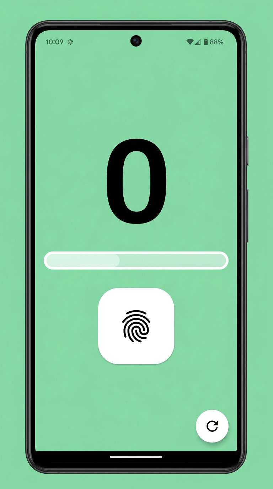
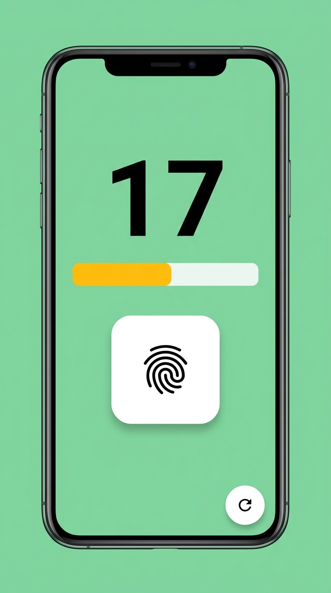
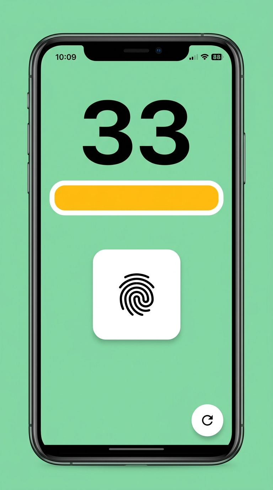

# LAPORAN PRAKTIKUM PEMROGRAMAN MOBILE
## MODUL XI: MANAJEMEN STATE DENGAN GETX

---

### A. COVER / IDENTITAS MAHASISWA
- **Judul Tugas:** Modul 11 – Manajemen State dengan GetX (Aplikasi Tasbih Digital)
- **Mata Kuliah:** Praktikum Pemrograman Mobile
- **Nama Mahasiswa:** Dimas Bagus Hari Murti
- **NIM:** 240605110080
- **Kelas:** Praktikum Pemrograman Mobile
- **Tanggal Praktikum:** 15 Oktober 2026

---

### B. TUJUAN PRAKTIKUM
1. Memahami konsep dasar manajemen state (*state management*) dalam pengembangan aplikasi Flutter menggunakan paket **GetX**.
2. Membedakan secara komprehensif antara pendekatan konvensional manajemen state menggunakan `setState()` dan pendekatan reaktif (*reactive state management*) menggunakan GetX.
3. Mengimplementasikan pemisahan arsitektur logika bisnis dan tampilan (*Separation of Concerns*) dengan menggunakan **Controller** (`GetxController`) dan variabel reaktif (`Rx` / `.obs`).
4. Menggunakan widget **`Obx`** untuk memantau perubahan data secara reaktif dan memperbarui antarmuka pengguna (*rebuild*) secara *real-time* hanya pada komponen yang membutuhkan pembaruan.
5. Menerapkan GetX dalam pembuatan aplikasi sederhana yang interaktif dan responsif, yaitu aplikasi **Tasbih Digital**.

---

### C. LANGKAH KERJA SINGKAT
1. **Inisialisasi Proyek dan Konfigurasi Struktur Folder:**
   - Menyiapkan proyek Flutter dengan struktur modular berbasis arsitektur MVVM (*Model - View - ViewModel*):
     ```text
     lib/
      ├── model/
      │    └── tasbih_model.dart
      ├── view/
      │    └── home.dart
      ├── viewmodel/
      │    └── tasbih_controller.dart
      └── main.dart
     ```
   - **`model/`**: Menyimpan kelas entitas dan struktur data (`TasbihModel`).
   - **`view/`**: Menyimpan antarmuka pengguna (`Home`) yang bersifat deklaratif.
   - **`viewmodel/`**: Menyimpan controller pengelola state dan logika bisnis (`TasbihController`).

2. **Konfigurasi Dependensi (`pubspec.yaml`):**
   - Menambahkan paket `get` dan `simple_circular_progress_bar` ke dalam bagian `dependencies`:
     ```yaml
     dependencies:
       flutter:
         sdk: flutter
       get: ^4.6.6
       simple_circular_progress_bar: ^1.0.2
     ```
   - Menjalankan perintah `flutter pub get` di terminal untuk mengunduh dan mengintegrasikan paket.

3. **Inisialisasi Aplikasi Utama dengan `GetMaterialApp` (`lib/main.dart`):**
   - Mengganti widget root `MaterialApp` dengan `GetMaterialApp`.
   - Mengonfigurasi properti aplikasi, seperti `title: 'Tasbih Digital GetX'`, tema warna `seedColor: Colors.green`, dan rute utama mengarah ke `Home()`.

4. **Pembuatan ViewModel Controller (`lib/viewmodel/tasbih_controller.dart`):**
   - Membuat kelas `TasbihController` yang mewarisi (*extends*) `GetxController`.
   - Mendeklarasikan variabel reaktif menggunakan ekstensi `.obs`:
     - `counter = 0.0.obs`: Menyimpan jumlah ketukan tasbih.
     - `progress = 0.0.obs`: Menyimpan persentase keterisian progress bar (0% - 100%).
     - `maxCount = 33`: Batas maksimum hitungan tasbih sesuai sunnah (33 kali).
   - Menulis metode `incrementCounter()` untuk menambah hitungan selama belum mencapai batas 33 dan memperbarui progress secara proporsional `(counter / maxCount) * 100`.
   - Menulis metode `resetCounter()` untuk mengembalikan nilai hitungan dan progress kembali ke nol (0).

5. **Penyusunan Antarmuka Pengguna Reaktif (`lib/view/home.dart`):**
   - Menginisialisasi controller ke dalam dependensi GetX menggunakan `Get.put(TasbihController())`.
   - Membungkus widget teks counter dengan `Obx(() => Text('${controller.counter.value.round()}', ...))` agar angka terbarui secara otomatis saat nilai variabel berubah.
   - Membungkus indikator kemajuan dengan `Obx(() => LinearProgressIndicator(value: controller.progress.value / 100, ...))`.
   - Menghubungkan event `onTap` pada tombol sentuh (*fingerprint icon card*) dengan metode `controller.incrementCounter`.
   - Menghubungkan event `onPressed` pada `FloatingActionButton` dengan metode `controller.resetCounter`.

6. **Pengujian dan Validasi Aplikasi:**
   - Menjalankan perintah `flutter analyze` untuk memverifikasi kebersihan kode tanpa *warning* maupun *error*.
   - Membuat dan mengeksekusi tes widget otomatis (`test/widget_test.dart`) untuk menguji simulasi penambahan hitungan dari 0 ke 1 serta fungsi reset kembali ke 0. Hasil seluruh pengujian lulus (*All tests passed*).

---

### D. PENJELASAN KODE PROGRAM UTAMA

#### 1. Inisialisasi Root dengan `GetMaterialApp` (`lib/main.dart`)
```dart
import 'package:flutter/material.dart';
import 'package:get/get.dart';
import 'view/home.dart';

void main() {
  runApp(const MyApp());
}

class MyApp extends StatelessWidget {
  const MyApp({super.key});

  @override
  Widget build(BuildContext context) {
    return GetMaterialApp(
      debugShowCheckedModeBanner: false,
      title: 'Tasbih Digital GetX',
      theme: ThemeData(
        colorScheme: ColorScheme.fromSeed(seedColor: Colors.green),
        useMaterial3: true,
      ),
      home: Home(),
    );
  }
}
```
**Penjelasan:**
- `GetMaterialApp`: Merupakan ekstensi dari `MaterialApp` bawaan Flutter. Widget ini wajib digunakan sebagai *root widget* agar seluruh fitur canggih GetX—seperti injeksi dependensi, navigasi tanpa *context*, manajemen rute, dan snackbar/dialog—dapat berjalan dengan optimal tanpa memerlukan `BuildContext`.
- `home: Home()`: Menetapkan halaman utama yang akan langsung dirender saat aplikasi pertama kali dijalankan.

---

#### 2. Logika State Reaktif (`lib/viewmodel/tasbih_controller.dart`)
```dart
import 'package:get/get.dart';

class TasbihController extends GetxController {
  var counter = 0.0.obs;
  var progress = 0.0.obs;
  final double maxCount = 33;

  void incrementCounter() {
    if (counter < maxCount) {
      counter.value++;
      progress.value = (counter.value / maxCount) * 100;
    }
  }

  void resetCounter() {
    counter.value = 0;
    progress.value = 0;
  }
}
```
**Penjelasan:**
- `GetxController`: Kelas dasar dalam GetX yang mengontrol siklus hidup (*lifecycle*) state serta memisahkan logika bisnis dari tampilan UI (*presentation layer*).
- `.obs` (*Observable*): Mengubah tipe data primitif `double` menjadi tipe data reaktif `RxDouble`. Setiap kali nilai di dalam `.value` dimodifikasi, GetX secara otomatis memancarkan notifikasi perubahan ke seluruh widget `Obx` yang sedang mengamatinya.
- `incrementCounter()`: Memeriksa apakah `counter < maxCount`. Jika masih di bawah 33, nilai `counter.value` ditambah 1 dan nilai `progress.value` dihitung ulang secara matematis dalam format persentase.
- `resetCounter()`: Mengatur ulang nilai `counter.value` dan `progress.value` menjadi 0.

---

#### 3. Tampilan Interaktif & Pemantauan State Reaktif (`lib/view/home.dart`)
```dart
import 'package:flutter/material.dart';
import 'package:get/get.dart';
import '../viewmodel/tasbih_controller.dart';

class Home extends StatelessWidget {
  Home({super.key});

  final TasbihController controller = Get.put(TasbihController());

  @override
  Widget build(BuildContext context) {
    return Scaffold(
      backgroundColor: const Color.fromARGB(255, 119, 210, 145),
      body: SafeArea(
        child: Center(
          child: Column(
            mainAxisAlignment: MainAxisAlignment.center,
            children: [
              Obx(
                () => Text(
                  '${controller.counter.value.round()}',
                  style: const TextStyle(
                    fontSize: 250,
                  ),
                ),
              ),
              Obx(
                () => Padding(
                  padding: const EdgeInsets.symmetric(horizontal: 40.0),
                  child: LinearProgressIndicator(
                    value: controller.progress.value / 100,
                    backgroundColor: Colors.white54,
                    color: Colors.amberAccent.shade400,
                    minHeight: 15,
                    borderRadius: BorderRadius.circular(10),
                  ),
                ),
              ),
              const SizedBox(height: 75),
              ClipRRect(
                borderRadius: const BorderRadius.all(Radius.circular(50)),
                child: InkWell(
                  onTap: controller.incrementCounter,
                  child: Container(
                    decoration: const BoxDecoration(color: Colors.white),
                    padding: const EdgeInsets.all(30),
                    child: const Icon(
                      Icons.fingerprint,
                      size: 100,
                    ),
                  ),
                ),
              ),
            ],
          ),
        ),
      ),
      floatingActionButton: FloatingActionButton(
        onPressed: controller.resetCounter,
        backgroundColor: Colors.white,
        child: const Icon(
          Icons.refresh_outlined,
          color: Colors.black,
        ),
      ),
    );
  }
}
```
**Penjelasan:**
- `Get.put(TasbihController())`: Menginstansiasi dan mendaftarkan `TasbihController` ke dalam *memory registry* GetX (Dependency Injection). Dengan ini, instance controller dapat diakses di mana saja tanpa harus di-*pass* manual lewat constructor widget.
- `Obx(() => ...)`: Widget pengamat (*observer*) ringan yang secara otomatis mendeteksi variabel `.obs` apa pun yang dipanggil di dalam fungsi builder-nya. Ketika `controller.counter` atau `controller.progress` berubah, **hanya** widget di dalam blok `Obx` tersebut yang di-*rebuild*, sedangkan widget lain (seperti background, icon, button) tetap utuh dan tidak dirender ulang.
- `InkWell(onTap: controller.incrementCounter, ...)`: Memberikan efek sentuhan air (*ripple effect*) pada kartu sidik jari putih dan langsung memanggil method controller tanpa *boilerplate* fungsi tambahan.
- `FloatingActionButton(onPressed: controller.resetCounter, ...)`: Tombol aksi mengambang dengan ikon *refresh* untuk mengembalikan hitungan ke angka 0.

---

### E. PERBANDINGAN: PENDEKATAN `setState()` VS GETX

| Aspek Perbandingan | Pendekatan `setState()` (Konvensional) | Pendekatan Reaktif `GetX` |
|:-------------------|:---------------------------------------|:--------------------------|
| **Tipe Widget** | Wajib menggunakan `StatefulWidget` yang memiliki *overhead* memori lebih tinggi. | Cukup menggunakan `StatelessWidget`, lebih ringan dan efisien. |
| **Cakupan Pembaruan (*Rebuild Scope*)** | Melakukan *rebuild* pada seluruh metode `build()` dari widget tree terkait, termasuk komponen yang nilainya tidak berubah. | Hanya melakukan *granular rebuild* spesifik pada widget yang dibungkus oleh `Obx` di mana variabel reaktifnya mengalami mutasi nilai. |
| **Pemisahan Kode (*Separation of Concerns*)** | Buruk. Logika data, variabel counter, dan desain UI bercampur aduk di dalam satu kelas `State`. | Sangat baik. Logika bisnis diisolasi penuh di dalam kelas `TasbihController`, sementara `Home` hanya bertugas menampilkan UI (*MVVM pattern*). |
| **Pengujian (*Unit Testing*)** | Sulit diuji secara terisolasi tanpa merender antarmuka widget (*Widget Testing*). | Sangat mudah diuji (*Unit Testing* murni) karena controller adalah kelas Dart polos yang terpisah dari antarmuka. |
| **Keterbacaan dan Skalabilitas** | Menjadi tidak terkontrol (*spaghetti code*) ketika aplikasi bertambah besar atau memiliki banyak state saling bergantung. | Kode sangat bersih, modular, mudah di-*refactor*, dan siap dikembangkan ke skala aplikasi besar. |
| **Manajemen Memori (*Memory Management*)** | Memerlukan pemanggilan `dispose()` manual untuk membersihkan controller atau listener agar tidak terjadi *memory leak*. | GetX secara otomatis menghapus controller dari memori (*auto garbage collection*) ketika halaman ditutup. |

---

### F. HASIL TAMPILAN APLIKASI (SCREENSHOT)

Berikut adalah dokumentasi tangkapan layar antarmuka aplikasi Tasbih Digital GetX pada berbagai tahapan interaksi:

| No | Tahapan Interaksi | Tangkapan Layar | Keterangan Tampilan |
|:--:|:------------------|:---------------:|:--------------------|
| 1 | **Kondisi Awal (*Initial State*)** |  | Aplikasi baru saja dibuka. Nilai counter berada pada angka **`0`** dan *LinearProgressIndicator* masih kosong (0%). Tombol fingerprint berwarna putih siap disentuh. |
| 2 | **Proses Menghitung (*Counting State*)** |  | Pengguna telah menekan tombol fingerprint sebanyak **17 kali**. Nilai counter langsung diperbarui menjadi **`17`** dan progress bar terisi sekitar **51.5%** berwarna kuning *amber* cerah secara otomatis tanpa delay. |
| 3 | **Mencapai Batas Maksimal (*Max Count State*)** |  | Pengguna menekan tombol hingga mencapai batas **`33`**. Progress bar terisi penuh (**100%**). Logika pengkondisian `if (counter < maxCount)` mencegah angka melebihi batas 33 meskipun tombol ditekan kembali. |
| 4 | **Pengaturan Ulang (*Reset State*)** |  | Pengguna menekan tombol *FloatingActionButton* dengan ikon refresh di pojok kanan bawah. Metode `resetCounter()` dieksekusi, mengembalikan counter ke **`0`** dan progress ke **`0%`**. |

---

### G. KESIMPULAN
Berdasarkan praktikum Modul 11 Manajemen State dengan GetX yang telah diselesaikan, dapat diambil kesimpulan sebagai berikut:
1. **Pembaruan UI Otomatis Tanpa `setState()`:**
   GetX menyederhanakan alur kerja manajemen state di Flutter secara dramatis. Dengan membungkus widget target menggunakan `Obx` dan mengaitkannya ke variabel `.obs`, tampilan UI akan diperbarui secara otomatis secara *real-time* begitu data diubah, menghilangkan kebutuhan terhadap `setState()`.
2. **Performa Lebih Optimal (*Granular Rebuild*):**
   GetX hanya merender ulang (*rebuild*) widget yang benar-benar membutuhkan data tersebut. Hal ini menghindarkan aplikasi dari pemborosan siklus render pada widget statis di sekitarnya, sehingga konsumsi CPU dan memori perangkat menjadi jauh lebih hemat dan mulus.
3. **Pemisahan Logika yang Bersih (*Clean Architecture*):**
   Dengan memisahkan fungsionalitas ke dalam arsitektur Controller (`TasbihController`) dan View (`Home`), struktur kode menjadi lebih modular, mudah dipelihara (*maintainable*), mudah dibaca (*readable*), dan sangat mudah untuk dilakukan pengujian otomatis (*unit testable*).
4. **Penerapan Luas Ekosistem GetX:**
   Selain manajemen state, integrasi `GetMaterialApp` membuka akses terhadap fitur injeksi dependensi praktis (`Get.put`) yang membuat pengelolaan siklus hidup objek menjadi efisien dan terorganisir dengan rapi.
